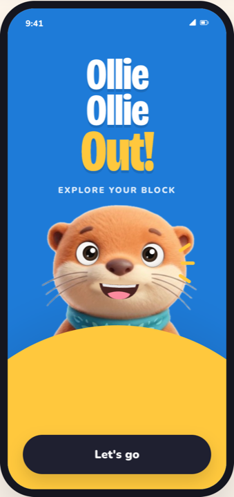
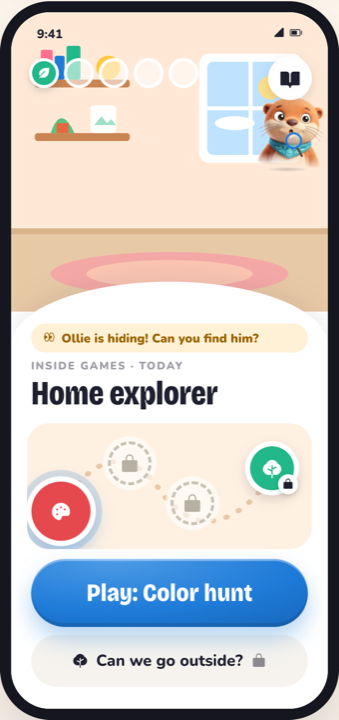
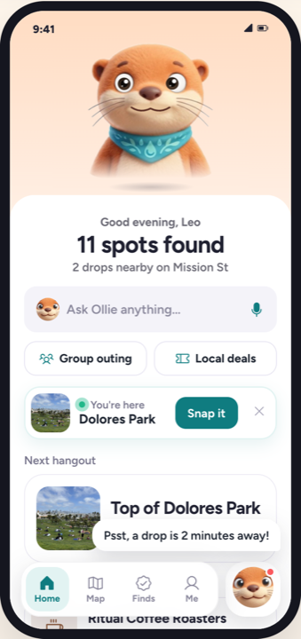
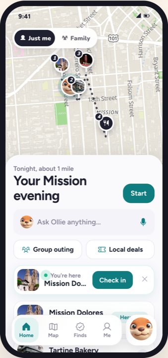
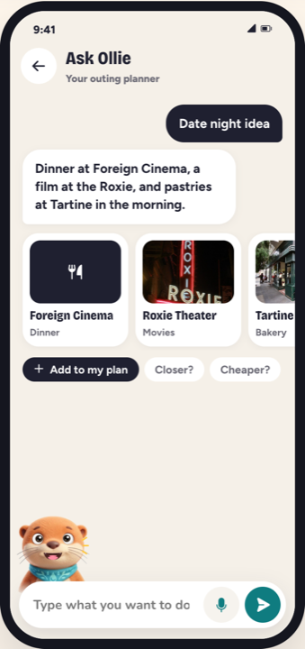

<div align="center">

# Ollie Ollie Out!

**One neighborhood outing app that reshapes for whoever is looking.**

Kid spots for kids, hangouts for teens, a full planner for adults. For a mixed group, only the spots that work for everyone, under the youngest person's rules.

Built by team **Explore your block** for the Build for Everyone hackathon (Google × k-ID), Games track.

[Clickable prototype](https://explore-your-block.vercel.app/prototype.html) · [Meet Ollie](https://explore-your-block.vercel.app/ollie.html) · [Design notes](docs/DESIGN-NOTES.md) · [API contract](docs/API.md)

&nbsp;
&nbsp;
&nbsp;
&nbsp;


</div>

## What it does

Ollie the otter takes you around your neighborhood (the demo uses real places in San Francisco's Mission District). What you see depends on your age and where you live, checked by [k-ID](https://k-id.com):

| | Kid (under 13) | Teen (13 to 17) | Adult (18+) |
| --- | --- | --- | --- |
| **Home** | Indoor games; outside only with a grown-up's OK | Hangouts: park, café, murals | A real map and a full outing planner |
| **Finding spots** | Tap "I found it!" and answer Ollie's quiz (no camera) | Photo challenge or trivia | Photo challenge or trivia |
| **Ask Ollie chat** | Off | On (in Germany, after a parent's OK) | On |
| **Buying** | Never shown | Ask a parent (Teen Pass as a gift) | Block Pass and Family Outing Pack |
| **Location** | Only inside a play zone, never shared | Per k-ID | On |

**Group outings** show only the spots that suit everyone and follow the strictest rule in the group. **Family mode** lets a parent plan for kids who don't have their own accounts. Kids and teens are never shown places that sell alcohol.

## Partners

| Partner | What it does in the app | Status |
| --- | --- | --- |
| **k-ID** | Age check, parent consent, and every permission | Age check works; server-side claim pending |
| **Inworld** | Ollie's voice, with a tone for each age | Mocked |
| **Modulate** | Voice questions, emotion, and hiding kids' personal details | Text works; audio mocked |
| **FastSpring** | Block Pass, Teen Pass, Family Outing Pack | Mocked; webhook signature check works |

## Quick start

You need **Node 20+**, **Python 3.10+**, and the k-ID SDK file `k-id-core-web.tgz`. It isn't in git because the repo is public: get it from the k-ID participant instructions.

```sh
git clone https://github.com/khush-i97/Explore-your-block.git
cd Explore-your-block
cp /path/to/k-id-core-web.tgz app/vendor/
cp app/.env.example app/.env     # add VITE_KID_PUBLISHABLE_KEY
./dev.sh                         # installs on first run, then starts both servers
```

| Open | What you get |
| --- | --- |
| http://localhost:5173 | The real flow: k-ID age check, then the app |
| http://localhost:5173/?demo | No k-ID: switch between Mia (8), Leo (14), Lena (14, Germany), Sam (32) and a family phone |
| http://localhost:8000/docs | The back end's interactive API docs |

> [!NOTE]
> For the real flow, the k-ID publishable key must list `http://localhost:5173` as an allowed origin in the k-ID portal. Otherwise you'll see "Couldn't reach k-ID". Use `?demo` until that's set.

## How it fits together

```
prototype/prototype.html ──sync_proto.py──▶ app/public/proto/   (the screens, as window.EYB)
                                                 │
app/ (React + Vite, :5173) ── k-ID SDK ──▶ k-ID  │  age check, permissions → screen rules
        │
        └── /api (proxied) ──▶ backend/ (FastAPI, :8000)   spots, groups, Ask Ollie, deals, checkout
```

- **`prototype/`**: the design source. One HTML file with every screen, plus the style board and Ollie's page. Edit the design here.
- **`app/`**: the React shell. It runs k-ID's age check, turns k-ID's permissions into screen rules, and mounts the prototype's screens. After a prototype change, run `python3 app/scripts/sync_proto.py`.
- **`backend/`**: the Python API, following [`docs/API.md`](docs/API.md). Partner calls are mocked until we have their details.
- **`docs/`**: design notes, the API contract, the build plan and the k-ID handoff.

## Tech

React 19, Vite, TypeScript · k-ID web SDK · FastAPI (Python) · Leaflet + MapLibre with OpenFreeMap tiles · Phosphor icons · Bricolage Grotesque, Figtree and Nunito fonts.

## Credits

Map © OpenFreeMap, OpenMapTiles and OpenStreetMap contributors. Place photos from Wikimedia Commons (full credits under the prototype). The partner shops in the demo are made up; no real business has signed up.

---

## Working notes

*Rough work from the team. We'll tidy this up later.*

# Explore-your-block
## Design + prototype

- **Clickable prototype:** https://explore-your-block.vercel.app/prototype.html (source in `prototype/`)
- **Design notes** (who sees what, onboarding + profiles, group mode, partners, design system): [`docs/DESIGN-NOTES.md`](docs/DESIGN-NOTES.md)
- **Build plan** and **k-ID handoff** PDFs: [`docs/`](docs/)
- **React app with the real k-ID SDK:** [`app/`](app/)
- **Python back end (FastAPI, follows [`docs/API.md`](docs/API.md)):** [`backend/`](backend/)

## Run it locally

Needs Node 20+ and Python 3.10+. Put `k-id-core-web.tgz` in `app/vendor/` (not in git) and copy `app/.env.example` to `app/.env` with the k-ID publishable key.

```sh
./dev.sh
```

- http://localhost:5173 is the real flow: k-ID age check, then the app. The key must allow `http://localhost:5173` as an origin in the k-ID portal.
- http://localhost:5173/?demo skips k-ID and lets you switch between Mia (8), Leo (14), Lena (14, Germany), Sam (32) and the family phone.
- http://localhost:8000/docs lists the API. Ask Ollie's answers come from `POST /api/voice/ask`. Partner calls (k-ID claim, Inworld, Modulate, FastSpring) still return mock or 501 answers.

After changing `prototype/prototype.html`, run `python3 app/scripts/sync_proto.py` to copy the new screens into the app.

#test maya test